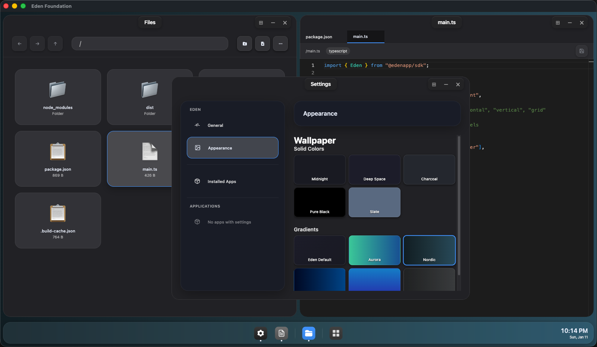

<div align="center">

# Eden

An Electron SDK for building a desktop environment with sandboxed apps.

[Read the handbook](docs/README.md) · [Build a consumer](docs/consumer-development.md) · [Build an app](docs/app-development.md)

[](LICENSE)
[](https://www.electronjs.org/)
[](https://www.typescriptlang.org/)

</div>



Eden supplies app windows, sessions, permissions, files, settings, and app communication.
A consumer embeds the SDK in its Electron main process and configures the product.
Apps run inside that desktop as web frontends, Node.js backends, or background services.

Frontends run in sandboxed `WebContentsView`s.
They request system work through typed commands.
Node.js backends run as trusted utility processes.
EdenCSS supplies shared styles, and Genesis packages apps as `.edenite` archives.

## Start developing

For your own Electron product, start with [Create a consumer](docs/consumer-development.md).
It covers installation, app selection, build assets, first-run data, and startup.

For an app that runs in Eden, start with [Create an app](docs/app-development.md).
It covers project generation, standalone development, system calls, and packaging.

The [handbook](docs/README.md) links the remaining tasks and defines the main terms.

## Run this repository

Use Git, Node.js 24.15 or later, and pnpm 11.1.2.

```bash
git clone https://github.com/b0czek/eden.git
cd eden
corepack enable
pnpm install
pnpm dev
```

`pnpm dev` prepares the SDK and starts its development host with watch mode.
Use `pnpm dev:example` to run the separate [consumer example](packages/example).

```bash
pnpm build       # build workspace packages
pnpm test        # unit and Node integration suites
pnpm typecheck   # workspace type checks
pnpm lint        # Biome checks
```

See [contributor testing](docs/testing.md) before adding or relocating tests.
See [controllers and domain events](docs/controllers.md) before changing SDK services or controllers.

## Packages

| Package | Purpose |
| --- | --- |
| [`@edenapp/sdk`](packages/sdk) | Desktop runtime, host API, built-in apps, and EdenCSS |
| [`@edenapp/scripts`](packages/scripts) | Consumer builds, app scaffolding, and development commands |
| [`@edenapp/client`](packages/client) | Promise-based app commands and subscriptions |
| [`@edenapp/types`](packages/types) | Shared manifests, commands, events, and injected API types |
| [`@edenapp/genesis`](packages/genesis) | App and DLC archive packaging |
| [`@edenapp/solid-kit`](packages/solid-kit) | SolidJS UI and lifecycle helpers |
| [`@edenapp/tablets`](packages/tablets) | File picker, context menu, and notification helpers |
| [`@edenapp/babel`](packages/babel) | App translations and shared labels |

## License

[MIT](LICENSE)
